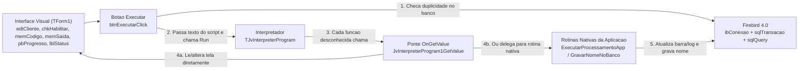

# Guia Completo de Entendimento — `unit1.pas` (Desafio Lazarus + JvInterpreter + Firebird)

Este guia divide todo o arquivo `unit1.pas` (`462` linhas) em **9 blocos lógicos** para você compreender cada decisão, comando e fluxo de comunicação do projeto `DesafioJvInterpreter`.

---

## Visão Geral: Como as peças conversam entre si

Antes de olhar linha por linha, entenda a arquitetura do programa em 4 camadas:



A grande sacada do desafio é que o **script escrito no `TMemo` não enxerga os botões nem o banco de dados diretamente**. Quando o script chama `LerNome()`, `DefinirProgresso(i)` ou `ExecutarProcessamento(50)`, o `JvInterpreter` dispara o evento `OnGetValue` da aplicação, que faz a tradução segura entre o script e o Lazarus/Firebird.

---

## Bloco 1 (Linhas 1–10) — Cabeçalho da Unit, Diretivas e `uses`

```pascal
unit Unit1;

{$mode objfpc}{$H+}

interface

uses
  Classes, SysUtils, Variants, IBConnection, SQLDB, Forms, Controls, Graphics,
  Dialogs, StdCtrls, ExtCtrls, ComCtrls, JvInterpreter;
```

### O que cada item faz aqui
- `unit Unit1;`: identifica o módulo principal do formulário. O nome precisa bater com o nome do arquivo (`unit1.pas`) e com o `uses` do `project1.lpr`.
- `{$mode objfpc}{$H+}`:
  - `{$mode objfpc}` ativa o modo orientado a objetos do Free Pascal (necessário para classes como `TForm1` e eventos com `@` nos bastidores).
  - `{$H+}` faz o tipo `string` significar `AnsiString` (strings grandes, sem o limite antigo de `255` caracteres do Turbo Pascal — essencial porque um script inteiro pode ter milhares de caracteres).
- `interface`: inicia a parte "pública" da unit — tudo o que outras units poderiam enxergar (as declarações de tipos e métodos).
- `uses`: lista as bibliotecas importadas:
  - `Classes`, `SysUtils`: utilitários básicos (`TStringList`, `Trim`, `IntToStr`, `FileExists`, `ForceDirectories`, `ExtractFilePath`, `Exception`).
  - `Variants`: fornece o tipo `Variant` e funções como `VarToStr` e `Null`, indispensáveis para trocar valores dinâmicos com o `JvInterpreter`.
  - `IBConnection`, `SQLDB`: componentes da camada SQLdb do Lazarus para conectar e executar SQL no Firebird (`TIBConnection`, `TSQLTransaction`, `TSQLQuery`).
  - `Forms`, `Controls`, `Graphics`, `Dialogs`, `StdCtrls`, `ExtCtrls`, `ComCtrls`: componentes visuais da LCL (`TForm`, `TButton`, `TEdit`, `TMemo`, `TProgressBar`, `TStatusBar`, `ShowMessage`, `TOpenDialog`, etc.).
  - `JvInterpreter`: traz o motor do interpretador Pascal (`TJvInterpreterProgram` e `TJvInterpreterArgs`).

---

## Bloco 2 (Linhas 11–72) — Declaração da Classe `TForm1` e Vínculo com o `.lfm`

```pascal
type

  { TForm1 }

  TForm1 = class(TForm)
    btnCarregarTxt: TButton;
    ...
    sqlTransacao: TSQLTransaction;
    procedure btnCarregarTxtClick(Sender: TObject);
    procedure btnExecutarClick(Sender: TObject);
    procedure btnSalvarTxtClick(Sender: TObject);
    procedure btnTestarBancoClick(Sender: TObject);
    procedure FormCreate(Sender: TObject);
    procedure JvInterpreterProgram1GetValue(Sender: TObject; Identifier: string;
      var Value: Variant; Args: TJvInterpreterArgs; var Done: Boolean);
  private
    function PastaScripts: string;
    procedure GarantirScriptsPadrao;
    procedure GarantirBancoETabela;
    function NomeJaExisteNoBanco(const ANome: string): Boolean;
    procedure GravarNomeNoBanco(const ANome: string);
    procedure ExecutarProcessamentoApp(QtdRegistros: integer);
  public

  end;

var
  Form1: TForm1;

implementation

{$R *.lfm}
```

### Como entender essa estrutura
1. **Campos dos componentes (linhas 16–47):** tudo que você desenha ou solta no Form Designer (`unit1.lfm`) é declarado automaticamente no topo da classe `TForm1` (visibilidade `published` implícita) para que o código Pascal consiga acessar `edtCliente.Text`, `pbProgresso.Position`, `ibConexao.Connected`, etc.
2. **Eventos (linhas 48–54):** são métodos ligados ao clicar de botões, criação da janela (`FormCreate`) ou ao interpretador (`JvInterpreterProgram1GetValue`).
3. **Seção `private` (linhas 55–61):** métodos auxiliares que nós mesmos criamos para organizar a lógica interna do formulário sem misturar tudo dentro de um único clique de botão:
   - `PastaScripts`: devolve o caminho da pasta `scripts\`.
   - `GarantirScriptsPadrao`: cria os scripts `.pas` de exemplo caso não existam.
   - `GarantirBancoETabela`: garante conexão, arquivo `.fdb` e tabela `NOMES`.
   - `NomeJaExisteNoBanco`: verifica duplicidade no banco.
   - `GravarNomeNoBanco`: insere o próximo código + nome no Firebird.
   - `ExecutarProcessamentoApp`: executa o processamento nativo na aplicação (chamado pelo script).
4. **`var Form1: TForm1;`**: variável global que guarda a instância da janela em execução.
5. **`implementation` + `{$R *.lfm}` (linhas 69–71):** marca onde começa o código de verdade das rotinas e diz ao compilador para embutir o arquivo visual `unit1.lfm` dentro do `.exe`.

---

## Bloco 3 (Linhas 75–144) — Criação Automática dos Scripts (`PastaScripts` e `GarantirScriptsPadrao`)

```pascal
function TForm1.PastaScripts: string;
begin
  Result := ExtractFilePath(Application.ExeName) + 'scripts' + PathDelim;
end;
```

- `Application.ExeName` retorna o caminho completo do executável (por exemplo `...\DesafioJvInterpreter\project1.exe`).
- `ExtractFilePath(...)` tira o nome do `.exe` e deixa só a pasta terminada com `\`.
- `PathDelim` adiciona a barra correta do sistema (`\` no Windows).
- Resultado prático: `...\DesafioJvInterpreter\scripts\`.

```pascal
procedure TForm1.GarantirScriptsPadrao;
var
  sl: TStringList;
  arq1, arq2: string;
begin
  ForceDirectories(PastaScripts);
  arq1 := PastaScripts + 'teste1_laco.pas';
  arq2 := PastaScripts + 'teste2_bidirecional.pas';

  sl := TStringList.Create;
  try
    if not FileExists(arq1) then
    begin
      sl.Text := ...;
      sl.SaveToFile(arq1);
    end;

    if not FileExists(arq2) then
    begin
      sl.Text := ...;
      sl.SaveToFile(arq2);
    end;
  finally
    sl.Free;
  end;
end;
```

### Pontos importantes desse bloco
1. **`ForceDirectories(PastaScripts)`**: cria a pasta `scripts\` automaticamente se ela ainda não existir.
2. **`if not FileExists(arq1)`**: só cria `teste1_laco.pas` e `teste2_bidirecional.pas` se estiverem faltando. Se você editar esses arquivos no bloco de notas ou dentro do sistema e salvá-los, na próxima abertura do programa eles **não** serão sobrescritos.
3. **`try ... finally sl.Free; end;`**: padrão obrigatório em Object Pascal. Mesmo que ocorra um erro de disco ao salvar o arquivo, o `finally` garante que o objeto `sl` (`TStringList`) seja liberado da memória sem vazamento (*memory leak*).
4. **O que fazem os 2 scripts gerados:**
   - **`teste1_laco.pas` (linhas 93–125):** implementa o fluxo principal do desafio — checa `OperacaoHabilitada()`, lê o nome com `LerNome()`, trava o botão (`HabilitarBotao(False)`), muda o status para `'Processando'`, faz o laço `for i := 1 to 100`, atualiza a barra em cada passo, registra no log a cada `10` (`(i mod 10) = 0`), grava no Firebird (`GravarNomeNoBanco(nome)`), muda o status para `'Concluído'`, reabilita o botão e mostra a mensagem final.
   - **`teste2_bidirecional.pas` (linhas 130–139):** implementa o teste de comunicação nos dois sentidos — o script lê o nome e chama `ExecutarProcessamento(50)`, entregando o controle para a aplicação executar o processamento nativo e atualizar a tela.

---

## Bloco 4 (Linhas 146–195) — Auto-criação do Banco Firebird e da Tabela `NOMES` (`GarantirBancoETabela`)

```pascal
  caminho := Trim(edtBanco.Text);
  if caminho = '' then
    raise Exception.Create('Informe o caminho da base Firebird (.fdb).');

  if ibConexao.Connected and (not SameText(ibConexao.DatabaseName, caminho)) then
    ibConexao.Connected := False;
```

- **`Trim(edtBanco.Text)`**: remove espaços acidentais antes/depois do caminho digitado.
- **`raise Exception.Create(...)`**: dispara uma exceção controlada se o campo estiver vazio; quem chamou (`btnTestarBancoClick` ou `btnExecutarClick`) captura e mostra o erro amigável na tela.
- **`if ibConexao.Connected and (not SameText(...))`**: se o usuário já estava conectado em um arquivo `.fdb` e trocou o caminho no campo `edtBanco`, primeiro desconecta a conexão antiga antes de conectar no banco novo (`SameText` compara textos ignorando maiúsculas/minúsculas).

```pascal
  if not ibConexao.Connected then
  begin
    pasta := ExtractFilePath(caminho);
    if pasta <> '' then
      ForceDirectories(pasta);

    ibConexao.HostName := 'localhost';
    ibConexao.UserName := 'SYSDBA';
    ibConexao.Password := 'masterkey';
    ibConexao.CharSet := 'UTF8';
    ibConexao.Dialect := 3;
    ibConexao.DatabaseName := caminho;

    if not FileExists(caminho) then
      ibConexao.CreateDB;

    ibConexao.Connected := True;
  end;
```

- Se a pasta do `.fdb` não existir, `ForceDirectories` cria a pasta.
- Configura os parâmetros do servidor Firebird local (`localhost`, `SYSDBA` / `masterkey`, `UTF8`, Dialeto SQL `3`).
- **`if not FileExists(caminho) then ibConexao.CreateDB;`**: atende ao **Extra 2** do desafio — se você digitar o caminho de um `.fdb` novo que ainda não existe, o próprio Lazarus manda o servidor Firebird criar o arquivo vazio antes de abrir a conexão (`ibConexao.Connected := True`).

```pascal
  sqlQuery.Close;
  sqlQuery.SQL.Text :=
    'SELECT COUNT(*) AS QTD FROM RDB$RELATIONS ' +
    'WHERE TRIM(RDB$RELATION_NAME) = ''NOMES''';
  sqlQuery.Open;
  tabelaExiste := sqlQuery.FieldByName('QTD').AsInteger > 0;
  sqlQuery.Close;

  if not tabelaExiste then
  begin
    sqlQuery.SQL.Text :=
      'CREATE TABLE NOMES (' +
      '  CODIGO INTEGER NOT NULL PRIMARY KEY,' +
      '  NOME VARCHAR(255) NOT NULL' +
      ')';
    sqlQuery.ExecSQL;
    sqlTransacao.Commit;
  end;
```

- **`RDB$RELATIONS`**: é uma tabela de sistema interna do próprio Firebird onde ficam registradas todas as tabelas do banco. Consultando se existe alguma linha com nome `'NOMES'`, sabemos com segurança se a tabela já foi criada.
- **`CREATE TABLE NOMES`**: caso ainda não exista (`not tabelaExiste`), cria a tabela com `CODIGO` como chave primária inteira (`PRIMARY KEY`) e `NOME` de até `255` caracteres (`VARCHAR(255)`).
- **`sqlTransacao.Commit;`**: confirma em definitivo o comando DDL (`CREATE TABLE`) no banco para a tabela ficar visível imediatamente para os próximos `SELECT`/`INSERT`.

---

## Bloco 5 (Linhas 197–249) — Validação de Duplicidade e Gravação (`NomeJaExisteNoBanco` e `GravarNomeNoBanco`)

```pascal
function TForm1.NomeJaExisteNoBanco(const ANome: string): Boolean;
var
  nomeLimpo: string;
begin
  nomeLimpo := Trim(ANome);
  if nomeLimpo = '' then
    Exit(False);

  GarantirBancoETabela;

  sqlQuery.Close;
  sqlQuery.SQL.Text :=
    'SELECT COUNT(*) AS QTD FROM NOMES ' +
    'WHERE UPPER(TRIM(NOME)) = UPPER(:P_NOME)';
  sqlQuery.ParamByName('P_NOME').AsString := nomeLimpo;
  sqlQuery.Open;
  Result := sqlQuery.FieldByName('QTD').AsInteger > 0;
  sqlQuery.Close;
end;
```

### Por que essa validação é segura
1. **`UPPER(TRIM(NOME)) = UPPER(:P_NOME)`**: converte tanto o que está salvo no banco quanto o parâmetro pesquisado para maiúsculas e sem espaços nas pontas. Assim, `"Leo"`, `"leo"` e `" LEO "` são reconhecidos como o mesmo nome.
2. **`:P_NOME` com `ParamByName`**: em vez de concatenar texto dentro do SQL (`'... = ''' + nome + ''''`), usamos parâmetro SQL. Isso evita erro quando o nome tem aspas simples (como `D'Ávila`) e protege contra *SQL Injection*.
3. **`Result := ... > 0;`**: retorna `True` se houver `1` ou mais registros iguais, e `False` se o nome estiver livre.

```pascal
procedure TForm1.GravarNomeNoBanco(const ANome: string);
var
  nomeLimpo: string;
  proxCodigo: integer;
begin
  nomeLimpo := Trim(ANome);
  if nomeLimpo = '' then
    Exit;

  if NomeJaExisteNoBanco(nomeLimpo) then
  begin
    memSaida.Lines.Add('Firebird: o nome "' + nomeLimpo +
      '" já está cadastrado (registro duplicado bloqueado).');
    Exit;
  end;

  GarantirBancoETabela;

  sqlQuery.Close;
  sqlQuery.SQL.Text := 'SELECT COALESCE(MAX(CODIGO), 0) + 1 AS PROX FROM NOMES';
  sqlQuery.Open;
  proxCodigo := sqlQuery.FieldByName('PROX').AsInteger;
  sqlQuery.Close;

  sqlQuery.SQL.Text := 'INSERT INTO NOMES (CODIGO, NOME) VALUES (:P_COD, :P_NOME)';
  sqlQuery.ParamByName('P_COD').AsInteger := proxCodigo;
  sqlQuery.ParamByName('P_NOME').AsString := nomeLimpo;
  sqlQuery.ExecSQL;
  sqlTransacao.CommitRetaining;

  memSaida.Lines.Add('Firebird: gravado CODIGO=' + IntToStr(proxCodigo) +
    ', NOME="' + nomeLimpo + '".');
end;
```

- **Dupla barreira**: além da checagem no botão Executar, `GravarNomeNoBanco` também bloqueia duplicidade se algum script chamar `GravarNomeNoBanco('...')` diretamente.
- **`COALESCE(MAX(CODIGO), 0) + 1`**: busca o maior código já existente na tabela; se a tabela estiver vazia (`MAX` retorna `NULL`), o `COALESCE` transforma `NULL` em `0` e soma `+ 1`, gerando o código `1` no primeiro registro, `2` no segundo, e assim por diante.
- **`CommitRetaining`**: grava definitivamente o `INSERT` no banco mantendo a transação ativa para o próximo uso sem fechar datasets vinculados.

---

## Bloco 6 (Linhas 251–291) — Rotina Bidirecional (`ExecutarProcessamentoApp`)

```pascal
procedure TForm1.ExecutarProcessamentoApp(QtdRegistros: integer);
var
  i: integer;
  nomeAtual: string;
begin
  if not chkHabilitar.Checked then
  begin
    memSaida.Lines.Add('Operação desabilitada pelo usuário (CheckBox desmarcado).');
    lblStatus.Caption := 'Status: Operação desabilitada';
    Exit;
  end;

  if QtdRegistros <= 0 then
    Exit;

  btnExecutar.Enabled := False;
  lblStatus.Caption := 'Status: Processando (' + IntToStr(QtdRegistros) + ' registros)...';
  pbProgresso.Position := 0;
  Application.ProcessMessages;

  try
    for i := 1 to QtdRegistros do
    begin
      pbProgresso.Position := Round((i * 100) / QtdRegistros);
      if ((i mod 10) = 0) or (i = QtdRegistros) then
        memSaida.Lines.Add('Registro ' + IntToStr(i) + ' de ' +
          IntToStr(QtdRegistros) + ' processado pela aplicação.');
      Sleep(20);
      Application.ProcessMessages;
    end;

    nomeAtual := Trim(edtCliente.Text);
    if nomeAtual <> '' then
      GravarNomeNoBanco(nomeAtual);

    lblStatus.Caption := 'Status: Concluído';
  finally
    btnExecutar.Enabled := True;
    Application.ProcessMessages;
  end;
end;
```

### O que acontece aqui
1. Essa procedure atende ao **item 4 do desafio (Comunicação nos dois sentidos)**: o script chama `ExecutarProcessamento(50)`, que cai em `OnGetValue` e dispara esta rotina nativa dentro do Lazarus.
2. Verifica se o `chkHabilitar` está marcado; se não estiver, registra o aviso e sai.
3. Desabilita o botão `btnExecutar` para o usuário não clicar duas vezes durante o processamento.
4. **Regra de três proporcional para a barra (`Round((i * 100) / QtdRegistros)`)**: mesmo que o script peça `ExecutarProcessamento(50)` ou `ExecutarProcessamento(200)`, a barra vai de `0%` a `100%` proporcionalmente.
5. **`Application.ProcessMessages`**: enquanto um `for` está rodando, a janela do Windows ficaria "congelada/Não respondendo" sem atualizar a barra de progresso até o laço acabar. `Application.ProcessMessages` pede para a aplicação processar as mensagens visuais pendentes a cada volta do laço.
6. **`Sleep(20)`**: dá uma pausa de `20` milissegundos por registro só para dar tempo de você ver a barra avançando na tela.
7. **`try ... finally btnExecutar.Enabled := True`**: se der qualquer erro no meio (por exemplo, o servidor Firebird estiver desligado ao chamar `GravarNomeNoBanco`), garante que o botão voltará a ficar clicável.

---

## Bloco 7 (Linhas 293–308) — Inicialização da Janela (`FormCreate`)

```pascal
procedure TForm1.FormCreate(Sender: TObject);
begin
  memSaida.Clear;
  lblStatus.Caption := 'Status: Aguardando';
  pbProgresso.Min := 0;
  pbProgresso.Max := 100;
  pbProgresso.Position := 0;
  edtBanco.Text := ExtractFilePath(Application.ExeName) + 'TESTE.FDB';

  GarantirScriptsPadrao;
  dlgAbrirPas.InitialDir := PastaScripts;
  dlgSalvarPas.InitialDir := PastaScripts;

  if FileExists(PastaScripts + 'teste1_laco.pas') then
    memCodigo.Lines.LoadFromFile(PastaScripts + 'teste1_laco.pas');
end;
```

Executa uma única vez assim que o formulário é criado na memória (antes de aparecer na tela):
- Limpa o log, define o texto inicial do status e configura a barra de `0` a `100`.
- Aponta `edtBanco.Text` por padrão para o `TESTE.FDB` dentro da mesma pasta do executável.
- Chama `GarantirScriptsPadrao` para garantir que a pasta `scripts\` e os dois exemplos `.pas` existam.
- Configura os diálogos de abrir/salvar (`TOpenDialog` / `TSaveDialog`) para já abrirem dentro da pasta `scripts\`.
- Carrega automaticamente o `teste1_laco.pas` dentro do editor `memCodigo`.

---

## Bloco 8 (Linhas 310–387) — A Ponte `JvInterpreterProgram1GetValue`

```pascal
procedure TForm1.JvInterpreterProgram1GetValue(Sender: TObject;
  Identifier: string; var Value: Variant; Args: TJvInterpreterArgs;
  var Done: Boolean);
```

Este é o **coração da integração** entre os scripts e o aplicativo.

### Como funcionam os parâmetros desse evento
Quando o `JvInterpreter` lê no script algo como `DefinirStatus('Processando')` ou `LerNome()`, ele não conhece essas palavras no Pascal padrão, então chama este evento passando:
- **`Identifier`**: o nome da função/procedimento que o script chamou (ex.: `'DefinirStatus'`). Comparamos com `CompareText(Identifier, '...') = 0` porque Pascal não diferencia maiúsculas de minúsculas.
- **`Args`**: os argumentos passados entre parênteses. `Args.Count` diz quantos parâmetros vieram, e `Args.Values[0]` traz o primeiro valor.
- **`Value`**: é onde devolvemos a resposta para o script (quando for função, como `LerNome()` ou `IntToStr(i)`). Quando for um comando sem retorno (`procedure`), colocamos `Value := Null;`.
- **`Done`**: começamos com `Done := False;` (padrão do componente). Quando reconhecemos o comando e executamos, **obrigatoriamente marcamos `Done := True;`** para avisar o interpretador que já resolvemos aquele identificador (senão ele lança erro de identificador desconhecido).

### Mapa completo das 12 funções/procedimentos expostos

| Identificador no Script | Args | O que faz na Aplicação | Retorno em `Value` | Linhas |
| :--- | :---: | :--- | :--- | :---: |
| `LerNome()` | `0` | Lê `Trim(edtCliente.Text)` | String com o nome digitado | 314–318 |
| `OperacaoHabilitada()` | `0` | Lê `chkHabilitar.Checked` | Boolean (`True`/`False`) | 319–323 |
| `MostrarMensagem(msg)` | `1` | Executa `ShowMessage(...)` | `Null` | 324–329 |
| `AdicionarLog(msg)` | `1` | Adiciona linha em `memSaida` + redesenha tela | `Null` | 330–336 |
| `DefinirProgresso(n)` | `1` | Atualiza `pbProgresso.Position := n` | `Null` | 337–343 |
| `DefinirStatus(texto)` | `1` | Atualiza `lblStatus.Caption := 'Status: ' + texto` | `Null` | 344–350 |
| `HabilitarBotao(ativo)` | `1` | Liga/desliga `btnExecutar.Enabled` | `Null` | 351–357 |
| `ExecutarProcessamento(qtd)` | `1` | Chama `ExecutarProcessamentoApp(qtd)` | `Null` | 358–363 |
| `GravarNomeNoBanco(nome)` | `1` | Chama `GravarNomeNoBanco(nome)` | `Null` | 364–369 |
| `NomeJaCadastrado(nome)` | `1` | Consulta `NomeJaExisteNoBanco(nome)` | Boolean (`True`/`False`) | 370–374 |
| `IntToStr(n)` | `1` | Converte inteiro para string para concatenar textos | String do número | 375–379 |
| `Pausar(ms)` | `1` | Executa `Sleep(ms)` + `Application.ProcessMessages` | `Null` | 380–386 |

> [!TIP]
> Observe os "casts" (conversões) usados em `Args.Values[0]`:
> - `VarToStr(Args.Values[0])` converte com segurança um `Variant` para `string`.
> - `Integer(Args.Values[0])` converte o `Variant` para número inteiro.
> - `Boolean(Args.Values[0])` converte o `Variant` para booleano (`True`/`False`).

---

## Bloco 9 (Linhas 389–462) — Cliques dos Botões (`btnExecutarClick`, `btnTestarBancoClick`, `btnSalvarTxtClick`, `btnCarregarTxtClick`)

### 1. `btnExecutarClick` (linhas 389–426)

```pascal
procedure TForm1.btnExecutarClick(Sender: TObject);
var
  nomeDigitado: string;
begin
  memSaida.Clear;
  pbProgresso.Position := 0;

  try
    try
      nomeDigitado := Trim(edtCliente.Text);
      if (nomeDigitado <> '') and NomeJaExisteNoBanco(nomeDigitado) then
      begin
        lblStatus.Caption := 'Status: Nome já cadastrado';
        memSaida.Lines.Add('Aviso: o nome "' + nomeDigitado +
          '" já está cadastrado no banco de dados.');
        sbStatus.SimpleText := 'Nome duplicado: ' + nomeDigitado;
        ShowMessage('O nome "' + nomeDigitado +
          '" já está cadastrado no banco de dados!');
        Exit;
      end;

      JvInterpreterProgram1.Pas.Text := memCodigo.Text;
      JvInterpreterProgram1.Run;
      sbStatus.SimpleText := 'Script executado com sucesso às ' +
        FormatDateTime('hh:nn:ss', Now);
    except
      on E: Exception do
      begin
        lblStatus.Caption := 'Status: Erro no script';
        memSaida.Lines.Add('ERRO: ' + E.Message);
        sbStatus.SimpleText := 'Erro no script: ' + E.Message;
        ShowMessage('Erro no script: ' + E.Message);
      end;
    end;
  finally
    btnExecutar.Enabled := True;
  end;
end;
```

#### Ordem exata do que acontece quando você clica em `▶ Executar Script`
1. Limpa o log anterior (`memSaida.Clear`) e zera a barra (`pbProgresso.Position := 0`).
2. Pega o nome digitado em `edtCliente`. Se não estiver vazio, consulta `NomeJaExisteNoBanco` **antes mesmo de rodar o script**: se já existir na tabela `NOMES`, avisa na tela e interrompe com `Exit`.
3. Joga o código do editor diretamente para o interpretador usando **`JvInterpreterProgram1.Pas.Text := memCodigo.Text;`** (usando `.Text` em vez de `.Lines` para evitar que quebras visuais do Windows quebrem strings do script).
4. Chama **`JvInterpreterProgram1.Run`**, que faz o parse e executa linha a linha do script.
5. **Bloco `try ... except` interno**: se o usuário digitar Pascal inválido no editor (erro de sintaxe) ou acontecer qualquer falha na execução/banco, o `except` captura a exceção `E`, mostra no status, escreve no log e exibe `ShowMessage` sem deixar o programa travar ou fechar.
6. **Bloco `try ... finally` externo**: mesmo que ocorra `Exit` por duplicidade ou erro no meio do script depois de `HabilitarBotao(False)`, o `finally` garante que `btnExecutar.Enabled := True` sempre seja executado no fim.

### 2. `btnTestarBancoClick` (linhas 428–442)
Chama `GarantirBancoETabela` manualmente quando você clica em **Conectar / Criar Base**, exibindo sucesso ou o motivo detalhado caso o caminho/serviço Firebird falhe.

### 3. `btnSalvarTxtClick` e `btnCarregarTxtClick` (linhas 444–460)
- `btnSalvarTxtClick`: abre `dlgSalvarPas.Execute`; se o usuário escolher um arquivo e clicar em Salvar, grava o conteúdo de `memCodigo` com `SaveToFile` e mostra o nome do arquivo na `StatusBar`.
- `btnCarregarTxtClick`: abre `dlgAbrirPas.Execute`; se o usuário escolher um `.pas` ou `.txt` do disco, carrega direto no editor `memCodigo` com `LoadFromFile` (cumprindo o **Desafio Extra 1** de rodar scripts externos de arquivos `.pas`).

---

## Resumo Rápido (Cola para Apresentar / Explicar o Desafio)

- **Como o script acessa os componentes visuais sem conhecê-los diretamente?**
  Pelo evento `JvInterpreterProgram1GetValue`, que intercepta chamadas como `LerNome()`, `DefinirStatus()`, `DefinirProgresso()` e `AdicionarLog()` e repassa para os controles da `TForm1`.
- **Como funciona a comunicação nos dois sentidos?**
  O aplicativo chama o script via `JvInterpreterProgram1.Run`, e o script chama de volta uma função nativa da aplicação (`ExecutarProcessamento(50)`), que executa `ExecutarProcessamentoApp` e atualiza os componentes visuais durante o laço.
- **Como erros de sintaxe e execução são tratados?**
  O `JvInterpreterProgram1.Run` roda dentro de `try ... except ... finally`, registrando a mensagem da exceção no log, no status e em um `ShowMessage`, além de sempre reabilitar o botão de execução.
- **Como o sistema cria o banco e evita nomes repetidos?**
  `GarantirBancoETabela` cria automaticamente o `.fdb` via `ibConexao.CreateDB` e a tabela `NOMES` consultando `RDB$RELATIONS`. Já `NomeJaExisteNoBanco` usa `UPPER(TRIM(NOME)) = UPPER(:P_NOME)` antes de executar o script e antes do `INSERT`.
